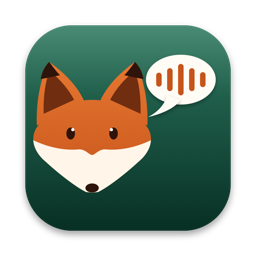
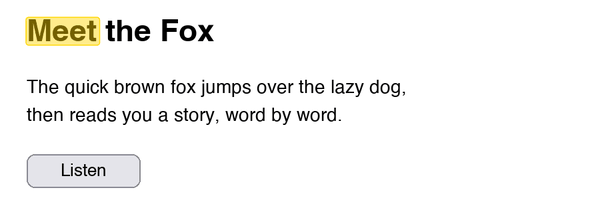
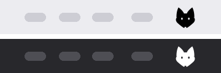
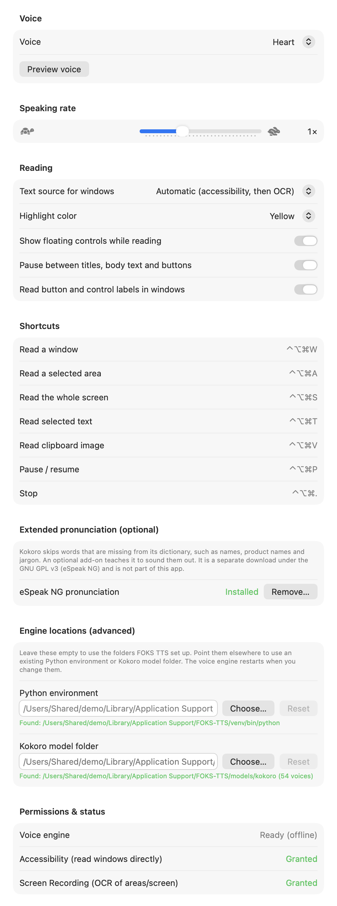

<p align="center"></p>

# FOKS TTS

**What does the FOKS say?** *F*ully *O*ffline *K*okoro *S*peech: a macOS menu bar app that reads text on your
screen aloud in a natural voice, following along word by word. Everything runs on your Mac; nothing is sent
anywhere.

> Would you read it in a box?
> Would you read it with a FOKS?
>
> *In a box, with a FOKS: yes! Drag a box around any text on your screen and FOKS TTS reads it back to you.*
>
> (With apologies to Dr. Seuss.)

<p align="center"></p>

## Screenshots

The menu bar icon, on a light and a dark menu bar (the app icon is at the top of this page):

<p align="center"></p>

Settings, opened from the menu bar icon (**Settings…**, or ⌘,). Paths shown are from a demo folder, not a real home directory.

<p align="center"><picture>
  <source media="(prefers-color-scheme: dark)" srcset="docs/settings-dark.png">
  
</picture></p>

## What it does

- **Reads what you point at:** a window, a dragged area, the whole screen, the text you have selected, or an
  image on the clipboard.
- **Highlights each word as it is spoken**, in place over the original text, using real per-word timing from the
  voice model.
- **Reads in sections.** It tells titles, body text and buttons or other controls apart and pauses briefly between
  them (with a clean, falling ending on each title or button label), instead of running everything together.
  It can be turned off in Settings.
- **Sounds natural.** It uses the [Kokoro](https://huggingface.co/hexgrad/Kokoro-82M) neural voice (28 English voices,
  American and British, male and female) running locally on Apple silicon through [MLX](https://github.com/ml-explore/mlx).
- **Is fully offline.** After installation it makes no network connections: no cloud service, no account, no
  telemetry. Speech, OCR and everything else happen on-device.
- **Has a speech-controller bar** (pause, stop, and a live speed slider from 0.5x to 2x), like the macOS Speech
  Controller, plus a Services-menu entry so you can start it from any app.

## Install

Requirements: Apple silicon Mac, macOS 14 or newer, the Command Line Tools (`xcode-select --install`), and
[uv](https://docs.astral.sh/uv/) (the installer will use Homebrew to get it if you have Homebrew).

```bash
git clone https://github.com/soulhakr/foks-tts.git
cd foks-tts
./install.sh
```

**With Homebrew** (from the author's tap; it builds from source, so it needs the Command Line Tools too):

```bash
brew install soulhakr/tap/foks-tts     # builds the voice environment and the app (downloads about 800 MB)
foks-tts-setup                         # copies FOKS TTS.app into ~/Applications and registers the Services entry
```

After `brew upgrade foks-tts`, run `foks-tts-setup` again (macOS asks for the permissions again, because the app is
rebuilt and ad-hoc signed). `foks-tts-setup --remove` removes the app copy and its settings; then `brew uninstall foks-tts`.

The installer builds an isolated Python 3.14 environment from a hash-locked requirements file, downloads the Kokoro
model at a pinned revision and verifies its SHA-256, speaks a test sentence offline, then builds **FOKS TTS.app**
and installs it to `~/Applications`. Everything else lives in `~/Library/Application Support/FOKS-TTS`.
It is safe to re-run. Options: `--no-app` (environment and model only), `--force` (rebuild). To remove it all:
`./uninstall.sh`.

`install.sh` honors one environment variable, `FOKS_TTS_HOME`, to install somewhere other than the default folder. The
app itself reads no environment variables (an app opened from Finder or launchd would not see your shell's anyway); to
use an existing Python environment or Kokoro model folder, set them under **Settings > Engine locations**. The log
(`~/Library/Logs/FOKS-TTS/foks.log`) records which locations are in effect at each launch.

## First run

1. Open **FOKS TTS** from `~/Applications`. It lives in the menu bar (a fox head). On a Mac with a notch the
   icon can be hidden when the bar is crowded; the hotkeys work regardless.
2. In its **Settings**, grant **Accessibility** (to read windows and selections directly). For reading an area or
   the whole screen, also grant **Screen Recording**. macOS may ask you to reopen the app after the second one.
3. Select some text anywhere and press **⌃⌥⌘T**.

## Ways to read

| Shortcut | Reads | Text comes from |
|---|---|---|
| **⌃⌥⌘T** | the text you have selected | Accessibility API (like macOS Speak Selection) |
| **⌃⌥⌘W** | a window you click | Accessibility API, falling back to OCR |
| **⌃⌥⌘A** | an area you drag | OCR (Apple Vision) |
| **⌃⌥⌘S** | the screen under the pointer | OCR (Apple Vision) |
| **⌃⌥⌘V** | the image on the clipboard | OCR; pairs well with a screenshot tool that copies to the clipboard |
| **Services menu** | selected text in any app | handed over by the app you are in |
| **⌃⌥⌘P** / **⌃⌥⌘.** | pause or resume / stop | |

**Services menu:** in any app, select text, right-click, then *Services > Read Aloud with FOKS TTS* (or use the
app's menu: *App name > Services*). It needs no permissions. If it is not listed, tick it once under
*System Settings > Keyboard > Keyboard Shortcuts > Services > Text*, where you can also assign a shortcut. The
service reads with the floating controls but cannot highlight in place.

**Settings** (from the menu bar icon): voice, speaking rate, where window text comes from (Accessibility, OCR or
automatic), highlight color, whether to show the floating controls, whether to pause between titles, body text and
buttons, whether to read button and control labels in windows, the Python environment and Kokoro model folder to use
(**Engine locations**), and the status of permissions.

## How it works

```
 pick a window / area / screen / selection
        |
        v
 text + word positions:  Accessibility API   or   Apple Vision OCR
        |
        v
 Kokoro voice (resident Python worker, MLX)  -->  audio chunks + per-word timestamps
        |
        v
 playback with a highlight that follows the spoken word
```

**Sections and pauses.** In a window, the accessibility tree says which text is a heading (web pages) or a button
and other control (any app), and gaps between blocks mark paragraphs. For OCR the app estimates type size (box height
and width per character) to spot titles, and treats a short line that stands apart as a button or label. A pause is
added wherever the kind of text changes, and a little at paragraph breaks. Services text pauses at blank lines.

Windows and selections are read from the target app's accessibility tree, which gives exact text and exact word
rectangles; when an app exposes no text (some Electron and web apps do so only after a moment, and the app retries
before giving up) it falls back to OCR. A resident Python process keeps the voice model loaded and streams the audio
sentence by sentence, so speech starts quickly.

## Privacy and permissions

- **Nothing leaves your Mac.** Network is used only during installation (PyPI, GitHub, Hugging Face); at run time the
  app and its voice engine run offline.
- **Accessibility** lets the app read text from other apps' windows and selections. **Screen Recording** lets it
  capture an area or the screen for OCR. Reading the clipboard image and using the Services menu need neither.
- **Logs** are written to `~/Library/Logs/FOKS-TTS/foks.log` and contain events, counts and timings only, never the
  text from your screen.

## Optional pronunciation add-on (GPL)

Kokoro skips words that are missing from its dictionary, such as names, product names and jargon. An optional add-on
teaches it to sound them out using eSpeak NG. Those packages are **GPL-licensed**, so they are **not part of the
default install**: install or remove them from *Settings > Extended pronunciation*, which shows the license notice and
asks first.

## Troubleshooting

| Problem | What to try |
|---|---|
| No icon in the menu bar | It may be hidden by the notch or a menu bar manager; use the hotkeys, or ⌘-drag the icon into view. |
| Nothing is spoken | Check `~/Library/Logs/FOKS-TTS/foks.log` for `worker ready`. The first launch takes about 10 s to load the voice. |
| "Not trusted" or permissions keep resetting | If you rebuild from source the app is ad-hoc signed, so macOS treats each build as a new app: grant the permissions again (remove the old entry with the minus button first). |
| A window reads via OCR instead of Accessibility | Some web and Electron windows expose little text; OCR needs the Screen Recording permission. |
| Services entry missing | Tick it under *System Settings > Keyboard > Keyboard Shortcuts > Services > Text*. |

## For developers

| Path | What it is |
|---|---|
| `app/Sources/` | the Swift menu bar app: hotkeys, picker overlays, capture, Accessibility and OCR, the reading session and overlay, settings UI |
| `app/tts_worker.py`, `tts_core.py` | the resident Kokoro worker: text cleanup, chunking, per-word timing, and fixes for upstream issues |
| `app/build_app.sh`, `app/install_local.sh` | build and ad-hoc sign `FOKS TTS.app`; install it to `~/Applications` and register the Services entry |
| `install.sh`, `uninstall.sh` | the installer and its inverse |
| `requirements/` | `core.lock` (69 hash-locked packages, no GPL), the optional GPL add-on lock, and `dev.lock` (test tools, not shipped) |
| `brand/`, `app/Icon/` | the color palette (`palette.json`, the single source of truth) and the procedurally drawn icon |
| `tools/gen_notices.py` | regenerates `THIRD_PARTY_NOTICES.md` from the installed packages |
| `tools/render_screenshots.sh` | re-renders the screenshots in `docs/` from the real views (`make screenshots`) |

```bash
cd app && ./build_app.sh                        # build "build/FOKS TTS.app"
build/"FOKS TTS.app"/Contents/MacOS/FOKS-TTS \  # headless check: render which word is highlighted when
  --read-image ../test_screenshot.png --snapshots /tmp/frames --at 0.5,2,4
python3 brand/build_palette.py                  # rebuild the palette and contrast table
```

Notes on the voice engine: `mlx-audio` 0.4.4 has a rounding bug that made some inputs fail
(`[broadcast_shapes]`), which `tts_core.py` patches at import, and it refuses to start without eSpeak, which
`tts_core.py` works around with a stand-in module. The brand rules (a rust fox on forest green or sand, never blue,
purple or yellow-orange, so it is not mistaken for other fox logos) are in [`brand/BRAND.md`](brand/BRAND.md).

## Roadmap

Next up: an optional **bring-your-own vision model** for cleaner reading of busy screens, and a signed, notarized
download later. See [ROADMAP.md](ROADMAP.md).

## Contributing and security

Bug reports and pull requests are welcome: see [CONTRIBUTING.md](CONTRIBUTING.md). To report a security problem, use the
private process in [SECURITY.md](SECURITY.md) rather than a public issue.

## License and credits

FOKS TTS is released under the [MIT License](LICENSE). Third-party software, the model and its data are listed with
full license texts in [THIRD_PARTY_NOTICES.md](THIRD_PARTY_NOTICES.md). GPL code is never bundled, and Gemma is not
included.

Built on the work of others: the [Kokoro-82M](https://huggingface.co/hexgrad/Kokoro-82M) voice model and
[misaki](https://github.com/hexgrad/misaki) by hexgrad, with architecture from
[StyleTTS 2](https://github.com/yl4579/StyleTTS2); [MLX](https://github.com/ml-explore/mlx) by Apple;
[mlx-audio](https://github.com/Blaizzy/mlx-audio) by Prince Canuma; [spaCy](https://spacy.io) by Explosion; and, for the
optional add-on, [eSpeak NG](https://github.com/espeak-ng/espeak-ng). Kokoro's training data includes the Koniwa and
SIWIS datasets, credited in the notices file.
